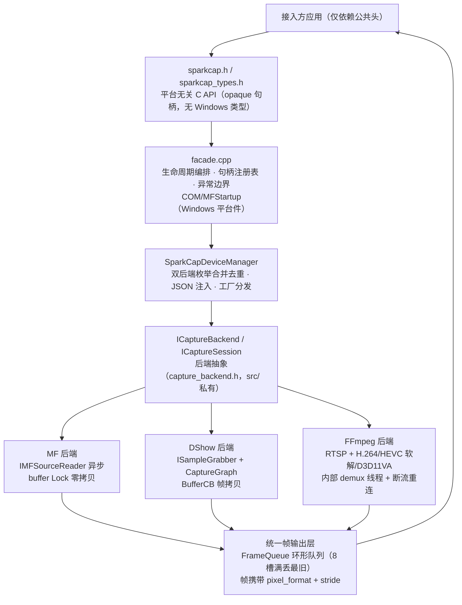
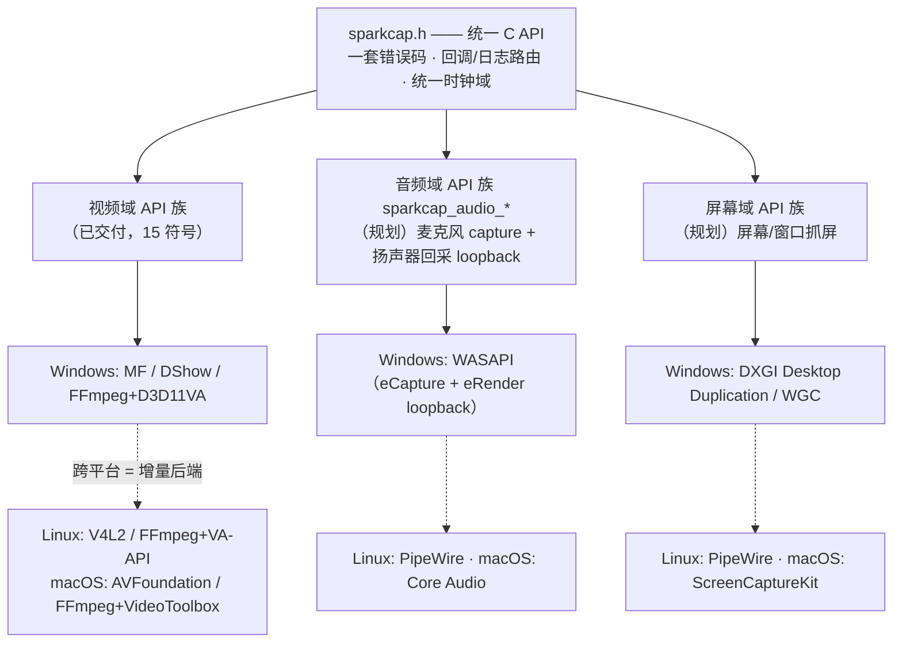

# SparkCap 技术选型方案

- 版本：1.3（§10 多域扩展架构预留 + §4/§10 架构图）
- 日期：2026-10-27
- 状态：待评审
- 关联文档：spec.md

---

## 1. 目标

在 Windows 平台提供高采集效率的摄像头统一封装库，对外保留 videoInput 式简单 API 风格，统一支持：

1. USB 摄像头（UVC）
2. 虚拟摄像头
3. 网络摄像头（IP Camera，RTSP 优先）

## 2. 需求要点

| 编号 | 需求 | 优先级 |
|---|---|---|
| R1 | 设备枚举，一次列出所有可用设备（含虚拟摄像头） | P0 |
| R2 | 统一打开/启动/取帧/停止/关闭 API | P0 |
| R3 | 保留原始像素格式（YUY2/MJPG/NV12），不做隐式转换 | P0 |
| R4 | 低延迟取帧，支持回调与主动拉取两种模式 | P0 |
| R5 | IP Camera（RTSP）采集，与本地设备同一设备列表 | P1 |
| R6 | 帧格式统一描述（pixel_format + stride） | P0 |
| R7 | 硬件加速解码（D3D11VA） | P1 |

## 3. 方案对比

### 3.1 设备枚举方案

| 方案 | 优点 | 缺点 | 结论 |
|---|---|---|---|
| 仅 DirectShow | 成熟、videoInput 即此路线 | 现代虚拟摄像头常只注册到 Media Foundation，枚举不到 | 否决 |
| 仅 Media Foundation | 系统原生、新设备覆盖好、支持异步读取 | 老设备兼容性略弱 | 不充分 |
| MF + DShow 双后端 | 覆盖全、可按设备来源择优 | 实现量增加 | 采用 |

### 3.2 IP Camera 采集方案

| 方案 | 优点 | 缺点 | 结论 |
|---|---|---|---|
| Windows MF RTSP 源 | 零依赖 | 认证弱、兼容性差、协议支持有限 | 不采用 |
| GStreamer | 功能全 | 引入整套框架，体积大 | 不采用 |
| 自研 RTSP 协议栈 + 解码 | 无第三方依赖 | 工作量巨大，维护成本高 | 不采用 |
| FFmpeg（libavformat + libavcodec） | 协议最全、硬解成熟、社区活跃 | 需自行 MSVC 编译与裁剪 | 采用 |

说明：ONVIF 仅用于设备发现与 PTZ 控制，媒体流仍走 RTSP，不能替代 RTSP 客户端组件。

## 4. 选定架构

总体策略：MF 优先、DShow 兜底、FFmpeg 负责网络流。

- DeviceManager：调用 MFEnumDeviceSources 与 DirectShow 双后端枚举，合并去重，维护设备表；打开时按设备来源自动选后端。
- MF 后端：基于 IMFSourceReader 异步读取，D3D11 路径 surface 直通实现零拷贝，CPU 路径经 IMF2DBuffer 减少拷贝，支持 MF_SA_D3D11_AWARE。
- DShow 后端：ISampleGrabber + CaptureGraph。
- FFmpeg 后端：处理 rtsp:// 流，H.264/HEVC 解码，接 D3D11VA。
- 统一帧输出层：环形队列 + 回调，帧结构携带 pixel_format 与 stride，不暴露后端差异。
- ICaptureBackend 抽象接口：新增后端上层零改动（FFmpeg 后端与其余二者线程模型/生命周期完全异质而共存于同一接口，即抽象层有效性的实证）。

## 5. 对外 API 风格

保留 videoInput 式简单调用：

    sparkcap_camera_list_devices(...)
    sparkcap_camera_open(deviceId, ...)
    sparkcap_camera_start(...)
    sparkcap_camera_get_frame(...) / 回调模式
    sparkcap_camera_stop(...)
    sparkcap_camera_close(...)

帧描述：

    struct Frame {
        void*        data;
        int          width;
        int          height;
        PixelFormat  pixel_format;   // 输出侧格式：NV12/YUY2/I420/MJPG/RGB24；RGB32 仅当设备原生输出
        int          stride;        // 符号表示行序：正 top-down，负 bottom-up（MF/DShow 统一语义）
        int          size;          // 帧数据字节长度：压缩格式必需；2D 格式 = |stride| × height
        int64_t      timestamp;
    };

## 6. 关键技术决策

| 主题 | 决策 | 理由 |
|---|---|---|
| 后端选择 | MF 优先、DShow 兜底 | 覆盖最广，老设备可用 |
| 网络流 | FFmpeg 静态裁剪内嵌 | 协议全、硬解成熟 |
| 像素转换 | 上层决定，库内不做隐式转换 | 降低延迟与不确定性 |
| 帧内存 | 库分配、库释放，提供 release_frame | 避免跨 DLL 堆崩溃 |
| GPU 直通 | MF 路径 MF_SA_D3D11_AWARE | 降低拷贝与延迟 |
| 硬解 API | D3D11VA，不选 QSV/NVDEC 专有路径 | D3D11VA 是 API 标准而非厂商私有：一套代码经驱动覆盖 Intel（Quick Sync）/ AMD（VCN）/ NVIDIA（NVDEC）全部三家；且与 MF surface 直通共享 D3D11 基础设施，GPU 帧过 C ABI 只设计一次 |
| 硬解回落 | D3D11VA 不可用时自动回落软解 | 无 GPU、虚拟机、远程桌面会话及个别 codec profile 驱动不支持时兜底；M3 软解兼作硬解的正确性基准 |
| 配置扩展 | JSON 增加 IP Camera 设备 | 不改代码即可接入 |

## 7. FFmpeg 集成策略

- 静态裁剪，仅保留 RTSP/RTP/TCP/UDP 协议、H.264/HEVC 解码、D3D11VA；
- 硬解经 `AV_HWDEVICE_TYPE_D3D11VA`（跨厂商，见 §6 决策），设备创建失败或 codec profile 不受驱动支持时自动回落软解；
- 由维护者以 MSVC v14.44 自行编译（工具集锁定记录于 VERSION 文件；主工程仅要求 VS2022 ≥ 14.30，14.x 系列二进制兼容），CRT 选项与主工程一致；
- 锁定稳定分支最新补丁 tag，记录于 third_party/ffmpeg/VERSION；
- libav* 头仅在 backend_ffmpeg 内部 include，符号不进导出表。

## 8. 风险与对策

| 风险 | 影响 | 对策 |
|---|---|---|
| 虚拟摄像头仅注册到 MF | DShow 枚举缺失 | 双后端合并枚举 |
| FFmpeg 官方包 ABI 不符 | 静态链接失败 | 自行 MSVC 编译 |
| 工具链漂移 | CRT/堆不一致崩溃 | FFmpeg 构建脚本锁定 v14.44；主工程门槛 VS2022 ≥ 14.30，14.x ABI 兼容 |
| RTSP 认证差异 | 部分摄像头连不上 | 参数化传输/认证，专项测试 |
| 许可合规 | 发布受阻 | 仅解码+系统硬解，法务确认 |

## 9. 里程碑

| 阶段 | 内容 | 产出 |
|---|---|---|
| M1 | 双后端枚举 + 本地设备取帧 | 可运行 Demo |
| M2 | 统一帧层 + 零拷贝路径 | 延迟数据 |
| M3 | FFmpeg 后端 + RTSP 接入 | IP Camera 取帧 |
| M4 | 硬解 + 断流重连 + 稳定性 | 验收通过 |

## 10. 多域扩展架构预留（v2 方向）

定位从"摄像头采集库"演进为"Windows 统一采集库"：摄像头（已交付）→ 屏幕/窗口抓屏、麦克风、扬声器回采（规划，见 roadmap.md）。本节锁定架构决策；域 API 细节见 Spec §9。

实线为 v2 交付范围（Windows）；虚线为跨平台路径——接口与契约不动，每平台是后端矩阵的增量行（§10.1）。

### 10.1 单库多域（不拆库）

- **A/V 同步是刚性需求**（录制/推流下游都要摄像头 + 麦克风对齐）：单库统一时钟域，多域时间戳同源可对齐；拆库则两套时基跨库对齐，做对极难
- 新增域零新增重依赖（WASAPI / DXGI Desktop Duplication / WGC 皆系统 API），DLL 体积不显著增长（大头 FFmpeg 已在）
- 接入体验：一个头文件、一个 DLL、一套错误码
- **拆库触发条件**：某域引入重依赖（如编码器）且体积不可接受——届时剥离为伴随 DLL（如 sparkcap-ffmpeg.dll，主 DLL 运行时探测、RTSP 不可用时优雅降级），而非重构现有库

### 10.2 选用模型：API 族即功能集

- 域 API 按前缀分族（`sparkcap_audio_*` 等），调用哪族即用哪域，无 feature flag、无运行时启用开关
- 域资源懒加载（延续现有模式：FFmpeg 网络层首次 RTSP open 才初始化、D3D11VA 创建失败回落），不调用的域零运行时代价
- 组合使用 = 各域会话句柄并存共享 backend（A8 多设备并发模型的推广）

### 10.3 扬声器回采（loopback）特性

"采集电脑播放的声音" = WASAPI loopback：在 **eRender 输出端点**上回环数字混音（数字级拷贝，与扬声器实际是否出声无关；区别于麦克风录音的空气传导）。四个架构要点：

1. **枚举分叉**：麦克风枚举 eCapture 端点，loopback 枚举 eRender 端点——音频枚举条目带 kind（capture / loopback）
2. **静默期语义必须契约化**：系统无播放时 WASAPI 不产生数据——静默期 get_buffer 返回 TIMEOUT 还是补零帧，须在 Spec 定义（录制/推流对两种行为的处理完全不同）
3. **格式不可控**：采样格式由系统混音器决定（应用不能指定），用户中途改系统采样率 → 流格式变化（重协商或经错误回调通知）
4. **进程级回采**（只采单个应用的音，Win10 2004+ Process Loopback API）：与端点级 loopback 是不同激活路径，列为 v2+ 候选

loopback 默认不包含麦克风声音（麦克风是独立 capture 流）；仅当应用把麦克风播放出来（侧音/侦听/虚拟调音台混音）才会进入端点混音。库不做隐式混音——"系统声音 + 麦克风"开两个会话独立成流，混音在应用侧。

### 10.4 编译期功能集（CMake option）

    option(SPARKCAP_ENABLE_VIDEO   "摄像头采集（MF/DShow）"  ON)
    option(SPARKCAP_ENABLE_FFMPEG  "RTSP 网络流 + D3D11VA"   ON)    # 已实现
    option(SPARKCAP_ENABLE_AUDIO   "麦克风/扬声器回采"       OFF)   # 域落地时引入
    option(SPARKCAP_ENABLE_SCREEN  "屏幕/窗口抓屏（DXGI 显示器整屏）"  ON)   # 已实现（v2 首域）

- **默认全开**：官方发布物 = 全功能单 DLL，生态只有一个标准产物（变体由自建者按需触发）
- 自建者裁剪：`FFMPEG=OFF` 出 **182KB** 纯本地采集 DLL（实测，全功能 3.7MB 的 4.7%；ws2_32 等 FFmpeg 系统依赖一并消失，依赖仅剩 5 个系统 DLL；15 个导出符号与 ABI 不变，实现方式为 CMake 源文件替换 `backend_ffmpeg_stub.cpp`，库代码零 `#if`，libav 头依赖隔离在 `src/pixfmt_av.h`）
- 三条纪律：头文件全量声明不变（未启用域运行时返回 `SPARKCAP_ERR_UNSUPPORTED`，ABI 不裂）；未来域 API 符号落地时 `.def` 按启用域拼接；CI 全功能跑全量 + 代表变体（FFMPEG=OFF）跑编译与单测，不做 2ⁿ 组合

### 10.5 屏幕域落地设计（v2 首域，Spec v1.4）

第一个多域扩展域，同时是 §10 架构的验证用例：并行入口、独立 API 族、复用通用设施。

**范围（首版）**：显示器整屏 + **窗口捕获**合并为 screen 域——域 = 接入方选用单位"桌面内容捕获"（推流/录制的主流目标），显示器/窗口是目标类型分叉 open 入口（同构于音频域 capture/loopback kind 分叉，§10.3-1）；会话层（start/get_frame/stop/close/回调/帧工具）全同构复用。

**双降级链**（start 时主后端失败自动回落，应用无感；对齐摄像头 MF→DShow、解码 D3D11VA→软解的既有哲学）：

| 目标 | 主后端 | 降级后端 | 降级触发 |
|---|---|---|---|
| 显示器 | DXGI Desktop Duplication（Win8+，GPU 事件驱动） | GDI BitBlt（CPU 轮询） | DuplicateOutput 失败（远程桌面/虚拟显卡/驱动不支持） |
| 窗口 | WGC（Win10 1903+，DWM 合成层） | GDI PrintWindow（PW_RENDERFULLCONTENT） | WGC 不可用（旧系统/策略/窗口类型） |

- **WGC 覆盖面**：DWM 合成层对渲染技术不敏感（Win32/UWP/Electron/Qt/D3D/OpenGL/Vulkan 窗口化全兼容）；PrintWindow+RENDERFULLCONTENT 同样直取 DWM 内容，硬件加速窗口大部分兼容
- **DXGI 旋转屏语义**：duplication 交付的桌面纹理恒为面板原生方向（landscape），`ModeDesc` 却是旋转后的桌面尺寸、`Rotation` 指示旋转方向——库内按 Rotation 转置读出，交付屏幕所见方向（竖屏出竖帧，与枚举 DesktopCoordinates 方向一致）；GDI/WGC 路径天然交付桌面方向，无需处理
- **GDI 后端如实限制**：CPU 拷贝（4K 帧 ~33MB）；旧 BitBlt 仅 GDI 窗口（仅作最后手段）
- **系统边界（库不绕过）**：管理员权限窗口需捕获进程同权限（UIPI）；最小化窗口 DWM 不合成；全屏独占游戏 DWM 不参与；系统黄框（防偷拍）——Win11 经 `IsBorderRequired=false` 官方 API 关闭（本库默认尽力关闭，F21 矩阵），Win10 仅系统级注册表可关（库不实现，如实保留黄框）

**语义契约（与摄像头域的关键差异，Spec F14/F18/F19/F21 契约化）**：

1. **帧唯一性不保证**：事件驱动后端（DXGI/WGC）静止时 `get_frame` 返回 TIMEOUT；轮询后端（GDI）定时交付重复帧——应用不假设帧的唯一性（预览无感，录制端重复帧=恒定帧率，均天然兼容）
2. **分辨率/格式不可协商**：目标原生尺寸、BGRA 固定；**fps 可限速**——`start(device, fps)`，fps>0 会话层统一节流（入队前时间戳判断，后端无关；不依赖 WGC MinUpdateInterval——其需 Win11）
3. **窗口状态契约**（会话层轮询 `IsIconic`/`IsWindow`，三后端行为统一）：最小化 → 错误回调 `SOURCE_PAUSED`（错误码 13）一次 + get_frame 返回 TIMEOUT（不补黑帧不补假帧），还原自动恢复（不通知，帧恢复交付即恢复）；关闭 → `STREAM_LOST`；resize → 帧尺寸跟随
4. **光标与边框可配置（best-effort，F21）**：`set_options(device, options)`，会话级、start 前设置；默认 0 = 帧不含光标 + 尽力关闭系统提示边框。**不报错原则**：不支持的后端/系统组合静默降级到该后端天然行为，接入方按矩阵设计而非靠返回码探测；未知位忽略（位掩码前向兼容）

   | 后端/系统 | CURSOR 未设（默认） | CURSOR 设置 | BORDER 未设（默认） | BORDER 设置 |
   |---|---|---|---|---|
   | DXGI 显示器 | 不含（天然） | 仍不含（静默） | 无框（天然） | 无框（静默） |
   | WGC @ Win11 | `IsCursorCaptureEnabled=false` | `=true` | `IsBorderRequired=false`（官方关闭路径） | 不调（系统默认黄框） |
   | WGC @ Win10 | **仍含光标（接口不存在）** | 含 | **仍黄框（关不掉）** | 黄框 |
   | GDI 兜底 | 不含（天然） | 仍不含（静默） | 无框（天然） | 无框（静默） |

5. **帧不含鼠标光标为默认**：光标层独立于桌面纹理；WGC 默认把光标画进帧，须显式 `IsCursorCaptureEnabled=false` 对齐 DXGI/GDI 天然行为（上表 CURSOR 默认列）；Win10 上关不掉（接口不存在），属已知行为差异
6. **dirty rects 不暴露**：整帧交付（完整 BGRA），脏区优化后置

**API 族（11 符号，导出 16 → 27）**：`sparkcap_screen_list_displays / list_windows / open / open_window / set_frame_callback / set_error_callback / set_options / start / get_frame / stop / close`。帧回调类型（`sparkcap_frame_cb`）、帧结构（`sparkcap_frame_t`）、帧工具（`sparkcap_copy_frame` / `sparkcap_release_frame`，通用层）直接复用。枚举条目 `sparkcap_display_info_t`（id/name/width/height/is_primary）与 `sparkcap_window_info_t`（hwnd/title/width/height——窗口列表为枚举时刻快照，open 时已关闭返回 NOT_FOUND）。

**实现路径**：`src/screen/`（与 `src/camera/` 同构的域目录）——`backend_dxgi.*`（显示器主后端：AcquireNextFrame → staging Map 按 RowPitch 逐行拷出 → 立即 ReleaseFrame）、`backend_wgc.*`（窗口主后端：WinRT COM 直调，零 C++/WinRT 包依赖）、`backend_gdi.*`（双目标兜底：BitBlt/PrintWindow 定时轮询）、会话层（目标类型 + 后端选择 + fps 节流 + 窗口状态轮询 + 环形队列复用 `common/frame_queue.h` + CallbackGuard）。时间戳 QPC→100ns 与 camera 域同源（A/V 时钟域前提）。`SPARKCAP_FEATURE_SCREEN = (1 << 2)` 功能位 + `SPARKCAP_ENABLE_SCREEN` CMake option（默认 ON，对齐 §10.4 默认全开）。
